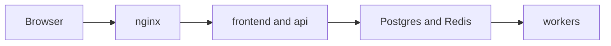
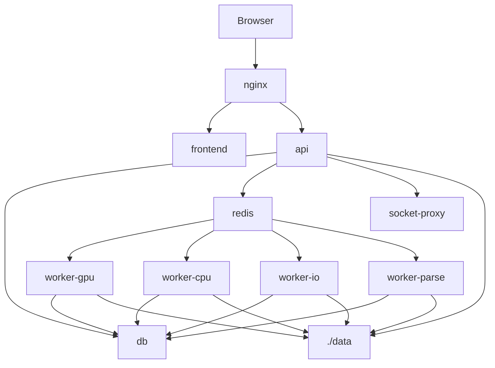
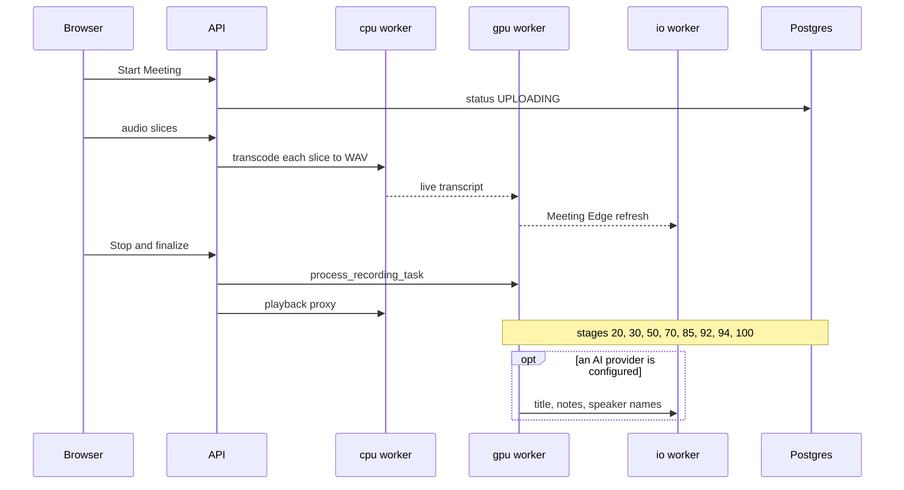
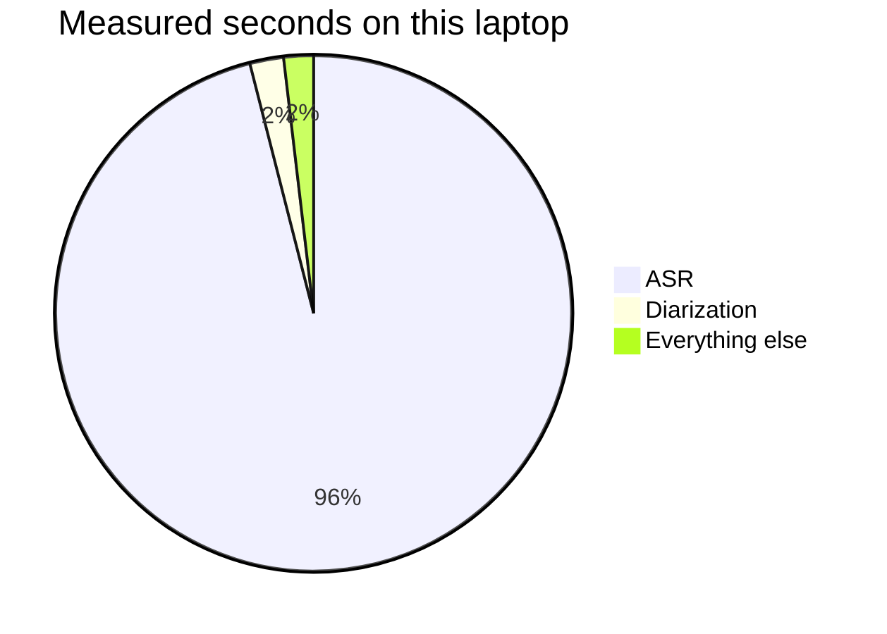
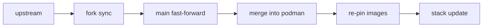

# How Nojoin works (on your Podman setup)

Nojoin is a self-hosted meeting recorder and transcriber. This note is the map of the copy running on the `podman` branch: what the ten containers do, what happens to one recording, and why a short clip can sit on "Transcribing audio" for a long time.

## In 60 seconds

Nojoin records a meeting in the browser and transcribes it on your machine. Desktop Chrome or Chromium shares a tab or window and mixes in the microphone. Mobile Chrome is the microphone only, and live capture needs HTTPS.\
The browser talks only to nginx. nginx serves the site and the API, the API stores the meeting in Postgres and queues work in Redis, and the workers write the transcript.\
Recording, transcription, speaker labels, search, and the measured analytics work with no AI account. Generated notes, chat, and live suggestions wait until you add a provider.\
Open https://localhost:14443. The certificate warning is this install's self-signed certificate.\
On this CPU-only laptop the slow step is speech recognition: one 8-second clip, first run, 2 threads, took 80.5 seconds, and 77.3 of those were Whisper.

## The big picture

Ten containers. nginx is the only one with host ports (`127.0.0.1:14141` to port 80, and `127.0.0.1:14443` to port 443). The API talks to Postgres, Redis, and socket-proxy. The four workers read their queues from Redis and write results to Postgres and to `./data`.

The stack is upstream `docker-compose.example.yml` plus `contrib/podman/compose.podman.yml`. The override pins the images to a release tag, removes the NVIDIA reservation so CPU is the default, resets logging, rewrites nginx's resolver for Podman's DNS, and mounts the Podman socket into socket-proxy. Nothing upstream is edited.

## What each container does

Celery is the job runner. Each worker listens on one queue. `worker_prefetch_multiplier` is 1, so each worker process holds a single job. A task that is not listed in the route table goes to the `gpu` queue.

| Service | What it does | Queue / concurrency |
| --- | --- | --- |
| db | Postgres 18 with pgvector. Meetings, users, transcripts, search vectors. Volume `postgres_data`. No host port. | none |
| redis | Broker and result store for Celery. Password-protected. Volume `redis_data`. | none |
| socket-proxy | Read-only view of the container API (`CONTAINERS=1`, `POST=0`). The API uses it for the admin log viewer and container status (`DOCKER_HOST=tcp://socket-proxy:2375`). On Podman the socket is `/run/podman/podman.sock`. | none |
| api | FastAPI, inside the network on port 8000. Holds the MCP connector. Mounts `./data` and `model_cache` read-only. Needs `FIRST_RUN_PASSWORD` to unlock `/setup`. | none |
| worker-gpu | Speech recognition, diarization, voiceprints, overlap analytics. The heavy worker. This fork removes the GPU reservation, so the same queue runs on CPU. | `gpu`, solo pool, concurrency 1 |
| worker-cpu | Turns each captured slice into 16 kHz WAV, builds the playback proxy, runs backups and delivery analytics. | `cpu`, prefork, concurrency 3 |
| worker-io | Notes, chat, speaker-name inference, meeting analysis, calendar sync, cleanup, telemetry. Also runs Celery Beat, so scheduled jobs fire once. The image adds Node.js for the Claude and Codex subscription route. | `io`, prefork, concurrency 4, plus Beat |
| worker-parse | Documents and search-index rebuilds. A large file can hold a slot for a long time, so it stays off the live-meeting lane. Children are recycled after 25 tasks. | `parse`, prefork, concurrency 2 |
| frontend | The Next.js site, inside the network on port 14141. | none |
| nginx | The door. Self-signed certificate, which is why the browser warns. | none |

The gpu queue is the one that fills up. Live transcription, the final pipeline, voiceprint rebuilds, and overlap analytics all land there, and any task the route table does not name lands there too. The cpu queue is ffmpeg and other local audio work, and it can run three jobs at once. The io queue is the network calls, plus Celery Beat, so the clock fires once. The parse queue is documents. Documents are parsed in an isolated lane because a parse has no page cap.

### On a timer

Beat runs inside worker-io, so each of these is enqueued once for the whole stack. The voiceprint task is routed to the gpu queue, which is where the model actually runs. A restart of worker-io moves the next telemetry ping, because Beat anchors that interval on its own last run.

| Job | Every | Where it runs |
| --- | --- | --- |
| Calendar sync | 15 minutes | io |
| Renew calendar push channels | 30 minutes | io |
| Index transcripts still missing search chunks | 15 minutes | io |
| Telemetry ping, only if that is turned on | 6 hours | io |
| Rebuild stale voiceprints, 25 recordings at a time | 6 hours | gpu |
| Re-measure delivery figures after a method change, 25 at a time | 6 hours | io, then the audio work it queues |
| Clean up temp recordings | 24 hours | io |
| Clean up leftover backup files | 6 hours | io |

When nothing is stale, the voiceprint and delivery sweeps return immediately. They are maintenance, not a sign that a meeting is stuck. The io lines show up in `stack logs -Service worker-io`. The voiceprint lines show up on worker-gpu, which is also where a transcription logs, so `stack timing` is the way to tell a rebuild apart from the meeting you are waiting on. It groups stages by recording id.

## Life of a recording

You press Start Meeting. The browser asks for a tab, window, or screen, plus the microphone, mixes the two, and uploads short slices. Closing the tab pauses the recording. The next visit asks you to resume, stop and process, or discard.

While a capture is running, a badge at the top of every page except the recording itself shows the elapsed time and the pause, resume, and stop controls. Clicking it opens that recording.

Search across meetings uses the `context_chunks` rows in Postgres (pgvector). `index_transcript_task` fills those after processing, and the 15-minute sweep catches any transcript the first pass missed.

Step by step:

1. `POST /recordings/init` creates the row as `UPLOADING`.
2. Each slice is `POST /recordings/{id}/segment?sequence=N`. `transcode_segment_task` on the cpu queue writes a WAV. `transcribe_segment_live_task` on the gpu queue writes the live transcript. That text has no speaker names yet. It also queues `refresh_meeting_edge_task` on the io queue.
3. Stop calls `POST /{id}/finalize`, which joins the slices and queues `process_recording_task` (gpu) and `generate_proxy_task` (cpu). The row becomes `QUEUED`, then `PROCESSING`.
4. `process_recording_task` walks the stages below. The percent is a fixed mark per stage. It does not creep forward while a stage runs.
5. If a provider is configured, `generate_meeting_intelligence_task` on the io queue writes the title, the notes, and speaker names. A local Ollama provider runs that step inline on worker-gpu instead. If no provider is configured, the meeting still completes, and speaker suggestions stay rule-based.
6. After the meeting is marked complete, three follow-ups are queued: `index_transcript_task` (io), `compute_delivery_analytics_task` (cpu), and `compute_overlap_analytics_task` (gpu).

The row's status is one of `UPLOADING`, `PAUSED`, `RECORDED`, `QUEUED`, `PROCESSING`, `PROCESSED`, `ERROR`, `CANCELLED`.

The live transcript is provisional, and it lags the conversation by a few seconds because it runs on slices rather than on single words. Speaker names appear on the final pass. Where the browser can tell the sources apart, a live line is labelled Microphone or Shared audio. The WAV the cpu worker keeps is 16 kHz and two-channel: channel 0 is the shared audio when there is any, and channel 1 is the microphone.

Switching to another application does not pause the capture. Only a real unload of the Nojoin tab does: refresh, close, or leaving the site. Moving between pages inside Nojoin keeps the recording going. If the tab closes before any audio has reached the server, there is nothing to resume, and Nojoin discards that recording.

A paused recording stays until you resume it, stop and process it, or discard it. Stop and process keeps the audio already uploaded and starts the pipeline. It does not need the original share picker. Discard revokes a running job and removes the recording.

You can also import a file and skip capture. The import accepts WAV, MP3, M4A, AAC, WebM, OGG, FLAC, MP4, WMA, and Opus, then joins the same final pipeline. Exports are TXT, PDF, or DOCX for the text, and MP3 for the audio.

### Pipeline stages

On a CPU machine the UI appends ` (CPU, may take a while)` to the step text. The strings below are the part the pipeline writes.

| Mark | Status text in the UI | What runs |
| --- | --- | --- |
| 20% | No step string is written here. An empty step shows "Preparing your meeting transcript." | The job has started and is resolving the audio file. |
| 30% | Filtering silence and noise... | Silero VAD, when `enable_vad` is on (the default). Under 1 second of speech ends the job as "Completed (No speech detected)". |
| 50% | Transcribing audio... | The transcription engine. The bar stays here for the whole of that call. |
| 70% | Determining who said what... | pyannote diarization: who spoke, not what they said. |
| 85% | Saving transcript... | Transcript saved. Speaker assignment and voiceprint matching run after this save, while the bar is still at 85%. |
| 92% | Finalizing transcript structure... | Transcript structure is finished, then notes if a provider is set. |
| 94% | Refining speaker boundaries... | A boundary pass with `pyannote/segmentation-3.0`, when that pass runs. |
| 100% | Completed | The meeting is done. Notes may still be generating on worker-io. |

The bar is stage-based, not a smooth clock. It sits at 50% for the whole transcription, which on this laptop is almost the entire wait.

Diarization uses the models in `bundled_models/pyannote/`: `speaker-diarization-community-1`, embeddings from `wespeaker-voxceleb-resnet34-LM`, and boundaries from `segmentation-3.0`. They ship with the repo, so this setup does not need a Hugging Face token.

A voiceprint is saved from a speaker's audio after that 85% save. A later meeting can match a new voice to someone already in People. Two voiceprints are only comparable when they were extracted the same way. When an upgrade changes that method, Nojoin rebuilds the old ones from the saved audio in the background, a few meetings at a time, on the gpu queue, so a live recording is not stuck behind a whole library.

## Why transcription is the slow part

The engine is OpenAI's `whisper` Python package. That is the original package. There is no compute-type switch and no beam size, which is what a faster-whisper setup would offer. The setting `transcription_backend` defaults to `whisper`. The other choices are `parakeet` and `canary`, both ONNX, and both int8 when they run on CPU.

The model setting `whisper_model_size` defaults to `turbo`. The choices are turbo, tiny, base, small, medium, and large. fp16 is used only when CUDA is present, so this machine runs fp32. Weights are cached under `$XDG_CACHE_HOME/whisper` (the `model_cache` volume). The turbo cache is about 1.6 GB.

You pick the model in setup wizard step 2, or later under Settings > Transcription. The model control on that page is for an admin. Getting Started still calls it Settings > AI. The wizard says: "Turbo (default) suits a server with an NVIDIA GPU. On a CPU-only deployment, Small or Base processes far faster. You can change this later in Settings > Transcription." The choice is stored in `config.json`. "Reprocess at higher quality" runs an old meeting again, and the same dialog can pick Parakeet or Canary for that one meeting. Language defaults to `auto`, and Whisper detects it.

`WHISPER_ENABLE_WORD_TIMESTAMPS` is set true on worker-gpu. Two other knobs matter: `enable_live_transcription` defaults to on, and that live pass shares the single gpu worker; `keep_models_loaded` defaults to off, so the model is loaded again on each job.

worker-gpu runs one job at a time (`--pool=solo --concurrency=1`). A live transcript and a finalize both need that slot, so they wait on each other. worker-cpu can run three lighter jobs at once. That split is why the page can feel idle while one core is busy.

Upstream compose sets `OMP_NUM_THREADS`, `MKL_NUM_THREADS`, `OPENBLAS_NUM_THREADS`, `VECLIB_MAXIMUM_THREADS`, and `NUMEXPR_NUM_THREADS` to 2 on every worker. The application never calls `torch.set_num_threads`, so those variables are the real thread cap. The Podman override raises the same five on worker-gpu only, to `${NOJOIN_ASR_THREADS:-8}`. worker-cpu, worker-io, and worker-parse stay at 2. `stack doctor` prints the count it will use, next to the CPU count from `podman info`, and warns if the value is not a whole number, is below 1, or is higher than the CPUs the machine can see. Leave a few cores for the other workers.

### What one clip actually did

Measured on this laptop, once: a Podman machine, rootful, on WSL, with 20 logical CPUs visible, about 33 GB of RAM, no GPU, SELinux off. The clip was 8.52 seconds of Spanish speech. First run. Model turbo on CPU. Threads at 2. worker-gpu sat at about 97% CPU, which is about one core of the twenty.

| Stage | Seconds |
| --- | --- |
| Silero VAD, speech found | 1.47 s of speech inside the 8.52 s clip (17%) |
| Final Whisper turbo call | 77.3 |
| Diarization | 1.7 |
| Segmentation refinement | about 0 |
| Final processing, total | 80.5 |
| Live transcription, same single worker, separate pass | 85.2 |
| Overlap analytics, a follow-up after the total above | 0.1 |

The clip paid for two speech-recognition passes on the single gpu worker: the live pass, 85.2 seconds, and the final pass, 77.3 seconds. The live pass is a second trip through the same one-at-a-time worker, so the meeting is already slow before you press Stop. The final pass can reuse the live result. It did not here. The 77.3 seconds is Whisper running again, on a first run, and that call loads turbo when it is not already in memory.

The pie is that same 80.5 second run. "Everything else" is the remainder, about 1.5 seconds, not a stage of its own. The live pass is outside this pie.

On the clock, that meeting went: live transcription first, 85.2 seconds, while the only gpu slot was busy; then after Stop, the finalize, which ran speech recognition again for 77.3 seconds instead of reusing the live result. Inside those 80.5 seconds, Whisper was 77.3 and diarization was 1.7. The bar sat on "Transcribing audio" for the Whisper call. Overlap analytics ran after the meeting was already marked complete, and took 0.1 seconds. VAD's 1.47 seconds is how much speech it found in the clip, not how long the filter took to run.

### The tuning ladder

Try them in this order. None of the speedups below were measured on the clip above. Turning live transcription off, the second step, does not change the final transcript.

`stack timing` is how you check. It reads the logs of `nojoin-worker-gpu` only, keeps the recording id, the stage name, and the elapsed time from each `pipeline_metric` line, and does not print the rest of that JSON. The default is the last 5 recordings. `-Since 30m` limits how far back it looks. Those logs are gone once the container is recreated. The command does not start or stop anything.

1. **`NOJOIN_ASR_THREADS`.** Set it in `.env`, then `stack start`, so Compose recreates worker-gpu. The default is 8, on that worker only. The 80.5 second measurement used 2 threads and about one core. Eight threads can use more of the twenty cores for the whole of the transcription, and the laptop has less CPU left for other work while that job runs. Stay at or under the CPU count `stack doctor` prints.
2. **Live transcription off.** `enable_live_transcription` defaults to on. Settings has no control for it. The settings registry lists that key among values with no frontend control, so there is no page and no visible label. The boolean is in `config.json`. Set it to false. While it is on, a captured slice enqueues a live speech-recognition task on the single gpu worker. Turning it off removes that pass. You lose the provisional transcript while recording, and Meeting Edge live suggestions, which are dispatched from that pass. Meeting Edge needs an AI provider anyway. The final transcript after Stop is unchanged, so this costs no transcription accuracy. The saving is expected to be about one speech-recognition pass. It was not measured on this clip.
3. **Whisper Small, in Settings > Transcription.** The wizard's own advice for a CPU-only machine. The page is labelled Transcription, and the model control is for an admin. Small and Base are the smaller Whisper models, so the same clip should finish sooner, and the transcript is less accurate than turbo. Change it there, or reprocess one old meeting if you only want to compare.
4. **Parakeet, optional.** Settings > Transcription, or the reprocess dialog, can switch the engine to Parakeet (NVIDIA's ONNX model, int8 on CPU). Canary is the other ONNX engine. It is a different model with different errors, and Parakeet stays on automatic language detection. There is no timing for it on this clip.
5. **`WHISPER_ENABLE_WORD_TIMESTAMPS=false`.** Set it in `.env` and start the stack again. worker-gpu then calls Whisper without the per-word alignment pass. Segment times remain. Per-word times do not. How many seconds that saves was not measured.

## AI: what needs it and what does not

| Works without an AI provider | Needs an AI provider |
| --- | --- |
| Browser recording and file import | Generated notes and titles |
| Transcription and diarization | Meeting Chat |
| People, voiceprints, and speaker matching | Automatic speaker-name inference |
| Search, tags, and tasks you create yourself | Meeting Edge, the live suggestions |
| Documents, including the local OCR fallback | The "What was discussed" analytics reading |
| Google and Outlook calendar sync, every 15 minutes | Visual parsing of a document page, when you ask for it |
| Measured analytics, playback, and TXT, PDF, DOCX, MP3 export | |

Action items live inside the generated notes. Creating a task is a separate step you do yourself.

Most of the Analytics tab is counted from the transcript's own timings, and delivery figures are counted from the audio when you ask. That half of the tab needs no provider. The section titled What was discussed is a model reading the transcript. It stays off until you press Analyse meeting. Documents are parsed on the parse worker. Text extraction and local OCR need no provider, so a scanned page can still be searched. Sending a page to a model is the separate "Analyse visually with AI" switch. If that model cannot see images, Nojoin falls back to the local OCR. OCR transcribes words. It does not describe a chart.

### Turning AI on later

"Decide later" in the setup wizard is a supported choice. The meeting still finishes, and you can generate notes afterwards for meetings recorded before a provider existed.

A server-wide key goes in `.env`: `GEMINI_API_KEY`, `OPENAI_API_KEY`, or `ANTHROPIC_API_KEY`, with `LLM_PROVIDER` (default `gemini`). Installation-wide provider defaults are Settings > AI providers, for an administrator. The keys themselves stay in `.env`. Each person sets their own route under Settings > Your AI, including a Claude or ChatGPT subscription. There is no default model. One has to be chosen, because the gate wants a provider key and a model. A secondary provider is optional and is used when the primary call fails. Its configuration is visible under Settings > AI providers, and the `SECONDARY_` values are set in `.env`.

Until that is set, an admin opening Chat sees: "Chat is disabled. Please configure an API key and select a model." Someone who is not an admin sees: "Chat is disabled. Please contact your administrator." A subscription that has come unplugged shows: "Chat is disabled. Your AI subscription is not connected."

| Route | How you turn it on | Where the text goes |
| --- | --- | --- |
| Gemini | `GEMINI_API_KEY` in `.env`. Install-wide provider: Settings > AI providers | Google |
| OpenAI | `OPENAI_API_KEY` | OpenAI |
| Anthropic | `ANTHROPIC_API_KEY` | Anthropic |
| Ollama | `OLLAMA_API_URL`, defaulting to the host on port 11434 | A process on hardware you run. Notes for this route run inline on worker-gpu. |
| Subscription | Your Claude Pro or Max plan through the Claude Agent SDK, or ChatGPT through the Codex CLI, on worker-io | Anthropic or OpenAI, through the subscription, with no API key stored |

> **What is sent, and what never is**
>
> For notes, the provider receives the transcript with speaker labels, your notes, linked calendar context, and the glossary. Chat sends the transcript, the notes, and the chat history. Meeting Edge sends the recent live transcript. A document page is sent only when you ask for visual parsing.
>
> Ollama is given that same text, and it stays on the machine you point `OLLAMA_API_URL` at.
>
> Audio never goes to a provider. The optional telemetry ping carries an install id, the version, and counts. It carries no meeting data.

## Where your data lives

| Place | What it holds |
| --- | --- |
| `./data` | Bind-mounted at `/app/data`. Source audio, WAV slices, and playback proxies under `recordings/`. Also `documents/`, `backups/`, temp directories, `logs/`, `cli-oauth/`, `.secret_keys.json`, `celerybeat-schedule.db`, and `config.json`. |
| `model_cache` | Named volume at `/home/appuser/.cache` in the workers, and read-only at `/shared_model_cache` in the API. Whisper weights and other downloaded models. |
| `postgres_data` | The database files. Meetings, transcripts, utterances, speakers, People and voiceprints, users, tasks, chat, `context_chunks` (the pgvector search index), documents, calendar rows, tags, processing runs. |
| `redis_data` | The Celery broker and result cache. `stack backup` skips it. |
| `bundled_models` | In the repo, under `bundled_models/pyannote/`. The diarization models. Not a volume, and not something `stack backup` copies. |

`.\contrib\maku.ps1 stack backup` writes a folder, by default `contrib/.local/backups/<timestamp>`:

- A consistent `pg_dump` custom-format archive, `postgres.dump`, from the running database. It does not export the `postgres_data` volume, because that snapshot would not be consistent.
- A copy of `./data`. If the stack was started with `-DataVolume`, it exports the `nojoin_data` volume instead of copying the folder.
- `model_cache.tar`, when that volume exists.
- `MANIFEST.txt` with the image tag and the list of what was written.

`redis_data` is skipped. The database user and database name are read from `.env` and are not printed.

Signing in from the browser uses a Secure HttpOnly session cookie. Other API clients send a bearer token. The MCP connector is its own OAuth 2.1 flow, and it only covers `/mcp`. `/setup` stays locked until `FIRST_RUN_PASSWORD` is entered, and the first account is the Owner. `DATA_ENCRYPTION_KEY` encrypts calendar credentials that have been stored. `stack install` fills in that key, the Redis password, and the first-run password when they are missing or still placeholders. It prints the first-run password only, and only when it has just generated one. Keep `DATA_ENCRYPTION_KEY` stable. Changing it cuts off calendar credentials that were encrypted with the old key.

## Running it on Podman

Two branches. `main` is a mirror of `Valtora/Nojoin`, fast-forward only. `podman` is that mirror plus `contrib/`, merged into and never rebased. No upstream file is modified, so the merge has nothing to conflict with.

First run on this machine is `.\contrib\maku.ps1 stack install`, then `https://localhost:14443/setup`. The wizard walks through the terms, the transcription model, the Owner account, the AI route, and a finish check that this browser can record. The sign-in page has no link to `/setup`. After that, `stack start` and `stack stop` are the everyday commands. `stack start` is safe to run again.

The site binds to `127.0.0.1` unless `NOJOIN_BIND_ADDRESS` says otherwise. Opening it from another device needs a reverse proxy in front, because live capture requires an HTTPS origin. Changing the port on its own does not provide that.

`fork sync` runs on the machine where you develop: it fetches upstream, fast-forwards `main`, merges `main` into `podman`, and moves the image pin to the newest published release. `stack update` runs on a machine that is already serving the app: it fast-forwards the current branch, pulls images when the pin changed, and recreates containers whose config changed.

`fork sync` fetches upstream, refuses if `origin` points at Valtora/Nojoin, and refuses if `main` already has commits of its own. It reads upstream's check runs and wants at least one success, unless you pass `-SkipUpstreamCiCheck`. Then it fast-forwards `main`, merges that into `podman`, and moves the pin forward to the newest `vX.Y.Z` whose api, worker, worker-io, and frontend images are already published. A dirty tree is refused. Nothing is force-pushed. On a machine that only runs the app, skip `fork sync` and use `stack update`.

Every command goes through `.\contrib\maku.ps1`. It needs PowerShell 7. The one-line descriptions are the help lines on each command.

| Command | What one run does |
| --- | --- |
| `stack install` | Create `.env`, pull the pinned images, start, and verify. Safe to re-run. Existing non-placeholder secrets are left alone. The first-run password is printed only when it was just generated. |
| `stack start` | Start the stack. Safe to re-run. Reuses the saved GPU and data-volume mode. |
| `stack stop` | Stop the stack. Volumes, `./data`, and the saved mode stay. |
| `stack logs` | Show stack logs. `-Follow` streams. `-Service` picks one service. |
| `stack update` | Fast-forward, pull images when the pin changed, and verify. |
| `stack verify` | Wait until healthy, then check health, nginx, the socket, and DNS. |
| `stack backup` | `pg_dump` Postgres, copy the data store, and export `model_cache` when it exists. |
| `stack doctor` | Check Podman, compose, secrets, ports, the data directory, and rendered config. Does not print secret values. |
| `stack timing` | Show per-stage processing times from the worker logs. |
| `fork sync` | Bring upstream `main` into `main`, merge it into `podman`, and re-pin images. |
| `fork status` | Ahead and behind against upstream, and the current image pin. |
| `images show` | Print the pinned tag and the fully qualified image refs. |
| `images pin` | Set `NojoinTag` and the compose default to one release. Does not commit. |
| `images verify` | Fail if `compose.podman.yml` disagrees with `images.psd1`. |

`stack start -Gpu` is experimental and untested on this machine. CPU is the default. `-DataVolume` stores `./data` in a named volume when the bind mount cannot be written from inside the machine.

`stack verify` waits until every health-checked service is healthy and the others are running, then checks the health URL, that the front page returns 200, that nginx is using Podman's nameserver, that the API can read its own logs through socket-proxy, that `host.docker.internal` resolves inside the API, and that user id 1000 can write `./data` and the model cache. It ends with DEPLOYMENT CHECK PASSED or DEPLOYMENT CHECK FAILED.

`stack doctor` checks the machine without printing secret values. A stopped Podman machine is started. It reports CPU count, checks that `.env` contains `FIRST_RUN_PASSWORD` and `DATA_ENCRYPTION_KEY`, warns on example placeholders, checks the rendered compose file for the saved mode, and prints whether SELinux is on. It also prints the ASR thread count against the CPUs the machine can see. It does not change the machine's memory or CPU.

## Known quirks

- The progress bar stays at 50% for the whole transcription. That mark means the speech-recognition stage is running. It is not a measure of how much of the audio is finished.
- The time-remaining estimate needs 3 processed recordings of at least 60 seconds on this machine. Until then the UI says it needs a few more processed recordings before it can estimate. After that, the estimate is the average seconds per audio minute, times this recording's minutes, minus time already spent.
- The browser warns about the certificate. nginx generates a self-signed certificate. `https://localhost:14443` is the right address anyway, because live capture requires HTTPS.
- `compute_overlap_analytics_task` can log a non-fatal "Format not recognised" when the audio library cannot open the `.webm` source file under `data/recordings/`. The task catches any exception in that step, because analytics must never fail a meeting, writes an overlap block with status `error` and an error message, and returns status `error`. The meeting still completes, and the rest of it is untouched.
- `POSTGRES_PASSWORD` is still the example value. Postgres publishes no host port, so the database is reachable only on the compose network. Decide on a real password before you store meetings you care about.

## Glossary

| Term | In one line |
| --- | --- |
| Celery | The job queue library. The API enqueues a named task. A worker process runs it. |
| queue | A Redis list of tasks. The four workers listen on `gpu`, `cpu`, `io`, and `parse`. |
| worker | A container running Celery. worker-gpu is the one that transcribes, and it runs one job at a time. |
| diarization | Splitting the audio by speaker. pyannote does this. Names come later, from a voiceprint match or from an AI pass. |
| VAD | Voice activity detection. Silero marks speech and mutes the rest before transcription. |
| ASR | Automatic speech recognition. The Whisper, Parakeet, or Canary call that produces text. |
| whisper | OpenAI's original `whisper` package, the default engine here. |
| turbo | The default Whisper model. Built for a GPU. On this CPU it is the slow choice. |
| voiceprint | A stored voice embedding on a People record, used to match a speaker in a later meeting. |
| pgvector | The Postgres extension behind `context_chunks`, so search can compare embeddings. |
| MCP | The connector on the API at `/mcp`, so an assistant you already run can read this library. OAuth is limited to that path. |
| ETA | The "time remaining" guess. It stays blank until 3 processed recordings of at least 60 seconds exist. |

## Where to look when something is off

| What you see | Where to look |
| --- | --- |
| A meeting sits on Processing | `stack logs -Service worker-gpu`, then `stack timing`. If the step says "Transcribing audio", that is the 50% stage in the table above. |
| The page will not load | `stack verify`, then `stack doctor`. |
| Chat says it is disabled | The AI section above. No provider and model yet, or the subscription is disconnected. |
| Transcription feels slow | The tuning ladder above. Measure with `stack timing` before changing a second knob. |
| A port is already in use | `stack doctor`. The published ports are 14141 and 14443 on `127.0.0.1`. |
| The certificate warning | Known quirks. Continue to `https://localhost:14443`. |
| The log mentions "Format not recognised" on a webm | Known quirks. Overlap analytics only. The transcript is already saved. |
| Time remaining never appears | Known quirks. Process three meetings of at least a minute. |
